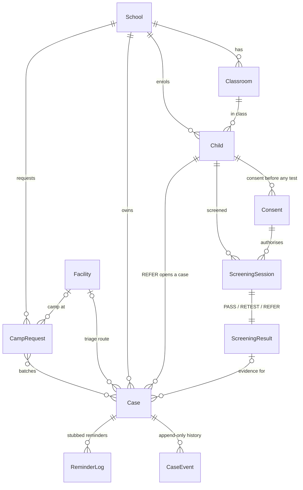
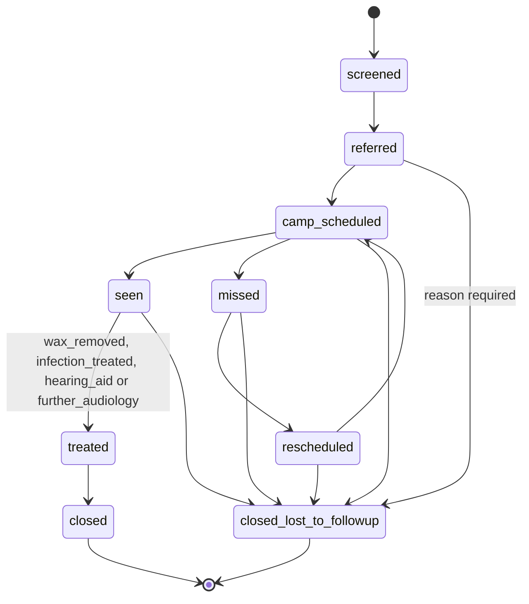

# Architecture

> Screening and referral tool, not a diagnostic device.

Part (a) describes the original DhwaniSarathi system as it is in this repo. Part (b) describes what we are building.

## (a) Original system (as-is)

### Components

```
audiometer/  Expo SDK 49 app (React Native 0.72, expo-router 2, expo-av). Firebase Auth for login.
server/      Django + DRF + SQLite. One app: apigateway. Function-based views, no authentication.
```

The app talks to the server over plain HTTP at a hardcoded LAN IP (`audiometer/app/Constants/ip.js`).
It does not work offline: results are POSTed at the end of a test.

### Data model (`server/apigateway/models.py`)

| Model | Key | Fields |
|---|---|---|
| LoginInfo | FID (Firebase UID) | Type (0 = student, else educator) |
| User | UID | UserName, Age, Gender |
| Educator | EID | EducatorName, InstituteName |
| Classroom | CID (UUID) | EID → Educator, ClassroomName, Count |
| Assignment | AID (UUID) | CID → Classroom, AssignmentName, Deadline |
| UserAssignmentResults | auto id | AID, UID, CID, Timestamp, Results (JSON) |
| UserOnlyResults | auto id | UID, Timestamp, Results (JSON) |

### Endpoints (`server/backend/urls.py`)

`/logininfos/`, `/users/`, `/educators/`, `/educators/<EID>/classrooms/`, `/classrooms/`,
`/classrooms/<CID>/assignments/`, `/assignments/`, `/assignments/<AID>/userassignmentresults/`,
`/assignments/<AID>/validate/`, `/userassignmentresults/`, `/useronlyresults/`, `/results/<UID>/`, `/admin/`.
List endpoints accept GET/POST; detail endpoints accept GET/PUT/DELETE. None require authentication.

### Screens (`audiometer/app/Screens/`)

Login, Signup, GetStarted, HomeNew, UserTutorial, BeforeTest1 (preliminary checks), QuietPlaceDetection (noise),
EarTest (headphone orientation), JewelleryDetection, AudiometryTest (`app/AudiometryTest.js`), Results,
Educator/* (classrooms, assignments, analytics), Maps / MapData, ML (document digitisation), LegalComplianceInformation.

### Test algorithm (`audiometer/app/utils/Audiometry.js`, `utils/CONFIG.js`)

- Frequencies 250, 500, 1000, 2000, 4000, 8000 Hz; left ear then right ear; an unmasked pass then a "masked" pass for each.
- Levels start at 0 and ascend in 10 dB steps up to 140 (`AMPLITUDE_PTS`). The first "yes" records that level as
  the threshold and jumps to the next frequency. There is no descending bracket, no catch trial and no response window.
- Each tone is a pre-generated stereo WAV, 10 s long at 44.1 kHz (checked from the file header).
- Volume mapping is uncalibrated: `volume = 10^((dB − 75) / 20)`, clamped to 1.0. `MAX_DB = 75` is a fixed
  "device specific" constant. Every level from 75 upward plays at full volume, and the system volume is not checked.
- Results show a four-frequency pure-tone average per ear with a hearing category label (`Screens/Results.js`).
- Noise metering (expo-av `Recording` metering, which the expo-av docs describe in dBFS) runs on a separate screen
  **before** the test only. Nothing is measured while tones play. The colour thresholds there (60 / 80) look like
  positive dB SPL values, while dBFS readings are ≤ 0. To confirm on a device in the Phase 1 spike.

## (b) Target architecture (ours)

```
screener/  Expo app (current SDK, Expo Go compatible), offline-first
  expo-sqlite  local DB: every write lands here first
  outbox       table of pending changes, pushed on "Sync"
  src/rules/   JS port of the rule engine
  flows        consent → device/volume check → L/R check → quiet baseline → screening → result → triage → case
        │  HTTPS/HTTP on LAN, only when the teacher taps Sync
        ▼
server/   Django 5.2 LTS + DRF + SQLite on a laptop
  apigateway/  original app (kept; auth added in Phase 2)
  referrals/   our app: School, Child, Consent, ScreeningSession/Result, Case, CaseEvent,
               CampRequest, ReminderLog (stubbed), Facility (local CSV)
               /sync/ idempotent batch upsert by client UUID
               rules/  Python reference rule engine
config/screening.json   every threshold, each with a "source" field; read by both rule engines
shared/fixtures/        JSON test vectors; pytest and jest must agree on every one
scripts/, eval/         simulator, NHANES rule evaluation, cost model, eval.report → eval/results.md, docs/CLAIMS.md
```

Key decisions:

- **Offline-first.** Screening, triage, case creation and status changes work with no network. Sync is manual and
  idempotent: every record has a client-generated UUIDv4.
- **Two-stage screening with reliability gating.** Fixed-level sweep, catch trials, per-tone noise gating during
  playback, immediate rescreen of failed frequencies only. Unreliable sessions become RETEST, never REFER.
- **Closed referral loop.** A REFER creates a Case with an explicit state machine
  (screened → referred → camp_scheduled → seen → treated → closed, plus missed / rescheduled / lost to follow-up),
  batched into camp requests for RBSK/DEIC teams. Reminders are logged, not sent.
- **Triage routing**, not diagnosis: a yes/no checklist routes a likely treatable cause to a PHC, otherwise to DEIC.
- **Sound levels** are relative to a biological calibration baseline ("dB re: team baseline").

## Screening app (Phase 4, built)

```
screener/src/
  app/index.tsx, settings.tsx, children.tsx, sync.tsx, screen/[childId].tsx   expo-router screens
  engine/engine.ts     timer-driven test state machine; time, randomness and audio injected through Port
  audio/useScreeningAudio.ts   expo-audio players + mic meter + earphone detection (one 100 ms tick)
  db/store.ts, sync.ts, index.ts   SQLite records + outbox; push to /api/sync/, pull case status
  rules/               shared rule engine (JS port)
  config.ts            imports ../../config/screening.json (metro.config.js watchFolders)
```

- **Noise gating = during_tone** (docs/SPIKE.md §5.4). The mic runs for the whole session. Each tone's metering
  samples go through `noise_verdict`: floor/missing samples, the mic settle window and the plug guard window are
  excluded; a tone is replayed if any valid sample is saturated or above `reference_quiet_db + gate_db_above_baseline`,
  or if too few valid samples remain.
- **Earphone detection** polls the live input device list (`getAvailableInputs()` = `AudioManager.getDevices`) for a
  wired headset, and rejects Bluetooth. Any change pauses the engine, stops the tone, discards the presentation, and
  needs the tester to resume. No tone is played unless wired earphones are present.
- **Storage**: one generic `records(type, id, data)` table whose `data` is exactly the backend serializer payload,
  plus `outbox` and `kv`. The full session log (trials, metering numbers, device changes) stays on the phone for
  export; audio recordings are deleted.

## Referral tracker backend (Phase 2, built)

`server/referrals/`. Every record has a client-generated UUID primary key. Token auth on every endpoint.



Case state machine (`referrals/state.py`, the only way status changes):



API (`/api/`, all need `Authorization: Token <key>`):

| Endpoint | Purpose |
|---|---|
| `POST /api/token/` | Username + password → token |
| `POST /api/sync/` | Batch upsert `{"records": [{"type", "id", "data"}]}`; types: school, classroom, child, consent, screening_session, screening_result, case, case_event. Per-record status `created` / `updated` / `duplicate` / `error`. Events go through the state machine; `from_status` detects conflicts |
| `GET /api/cases/?status=&school=&updated_since=` | Case list (the phone pulls updates with `updated_since`) |
| `GET /api/cases/<id>/` | Case with full event history |
| `POST /api/cases/<id>/transition/` | `{to_status, treatment?, reason?, note?}`; illegal → 400 |
| `GET/POST /api/camp-requests/` | Create from referred/rescheduled cases of one school; moves them to camp_scheduled |
| `GET /api/camp-requests/<id>/csv/`, `/pdf/` | Export with "SCREENING, NOT DIAGNOSIS" banner |
| `GET /api/reminders/` | Reminders that WOULD be sent (logged on `missed`; nothing is sent) |

Design notes: Case `status` is read-only in the API and in sync; it changes only through transitions. Our own
`Classroom` is used instead of `apigateway.Classroom`, which belongs to the original app's Firebase-based Educator
model. Facilities come from a local CSV (`manage.py load_facilities [path]`); the repo ships only `SAMPLE-*` rows.

## Screening rule engine (Phase 3, built)

Pure functions, written twice: `server/referrals/rules/__init__.py` (Python reference) and `screener/src/rules/index.ts`
(JS port, runs offline on the phone). Both are checked against the same 45 fixtures in `shared/fixtures/`
(`scripts/check_rules_parity.sh`). All thresholds come from `config/screening.json`.

| Function | Input | Output |
|---|---|---|
| `reliability_score` | trials | catch trials, false alarms, tone trials, out-of-window taps, score = 1 − (FA + OOW) / all trials |
| `rescreen_plan` | trials, noise events | `[ear, freq]` points not heard in round 1 (if rescreen is on) |
| `apply_500hz_policy` | ambient dB re: baseline | include 500 Hz or not, with reason |
| `decide_outcome` | trials, noise events | PASS / RETEST / REFER, per-ear outcomes, per-point status, reliability, reasons |
| `triage_route` | yes/no checklist answers | PHC or DEIC, the rule that fired, reason ("Triage, not diagnosis") |

`decide_outcome` order (first match wins):

1. Fewer catch trials than `reliability.min_catch_trials` → RETEST.
2. False-alarm rate or out-of-window rate above its limit → RETEST. **Unreliable never REFERs.**
3. Each point (ear × frequency, plus 500 Hz if tested): heard if at least `min_hits_per_point` taps fall inside
   [`min_response_ms`, `response_window_ms`]. A point missed in round 1 uses its rescreen result
   (heard on rescreen / not heard, confirmed / too noisy / rescreen missing). A point with no valid presentation
   because noise discarded them all is "too noisy".
4. An ear with a confirmed not-heard point → REFER; else any noisy, untested or not-rescreened point → RETEST; else PASS.
   Overall = worst ear.

Input shapes: a trial is `{round, kind: "tone"|"catch", ear?, freq?, responded, response_ms}`; a noise event is one
tone presentation discarded because the mic exceeded the noise gate: `{round, ear, freq}`.
