# Shravan Setu

School hearing **screening and referral** for the Seva First Innovation Challenge 2026. Screening only, never a
diagnosis. This repo is a fork of DhwaniSarathi (SIH 2023, Apache-2.0); the original team's README follows below,
unchanged. Credits: `ATTRIBUTION.md`.

**Calibration is provisional.** Tone levels come from a team baseline measured with 7 consenting adult volunteers on one phone and earphone model (Redmi 2201117TI + Samsung wired earphones, media volume 6 steps, 2026-10-19), not from children and not against an audiometer. At 500 Hz the baseline is a measured median. At 1, 2 and 4 kHz the phone could not play quietly enough to find the volunteers' real thresholds, so the baseline there is an upper bound. In plain words: the 1-4 kHz tones may be louder than intended, so the screen may miss milder hearing loss until the Stage 2 recalibration (`docs/ROADMAP.md`; `docs/CLAIMS.md` CAL-01..03; `docs/ERROR_LOG.md` ERR-044). Levels are dB re: team baseline, never dB HL.

## Design: Direction B "Setu Line" (chosen, v2)

Mock-ups for the visual polish pass, rendered from HTML with the real fonts, icons and illustrations. **These are not
screenshots of the running app.** All English and Telugu text comes from the app's `screener/src/i18n/strings.json`.
Full brief, contrast checks and the icon inspection: [`docs/DESIGN.md`](docs/DESIGN.md).

Night indigo and marigold, Tiro Telugu for titles and quotes, Hind Guntur for the interface, Baloo Tammudu 2 in child
mode. The setu line (a sound wave rising into a bridge), a muggu-inspired dot lattice, arch windows with hand-drawn
Open Peeps on teacher screens, and a Sankranti sky with kites for the child.

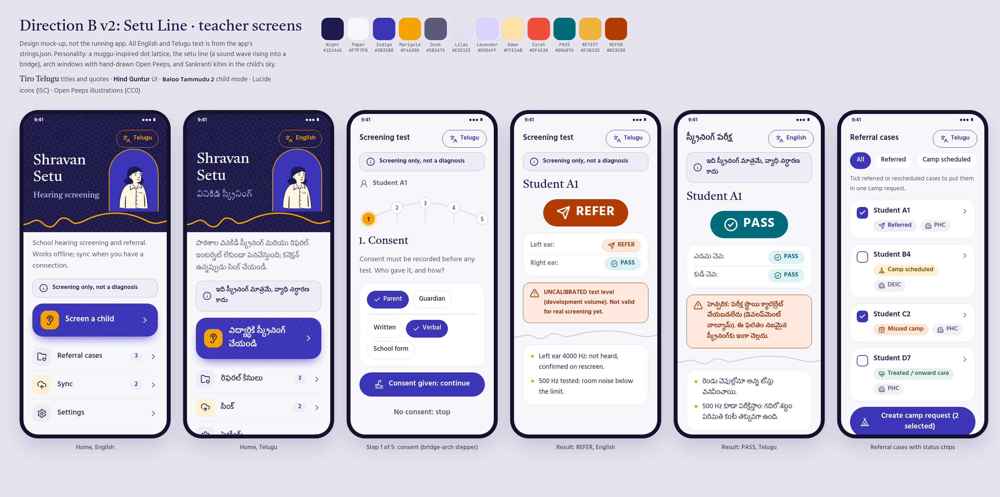

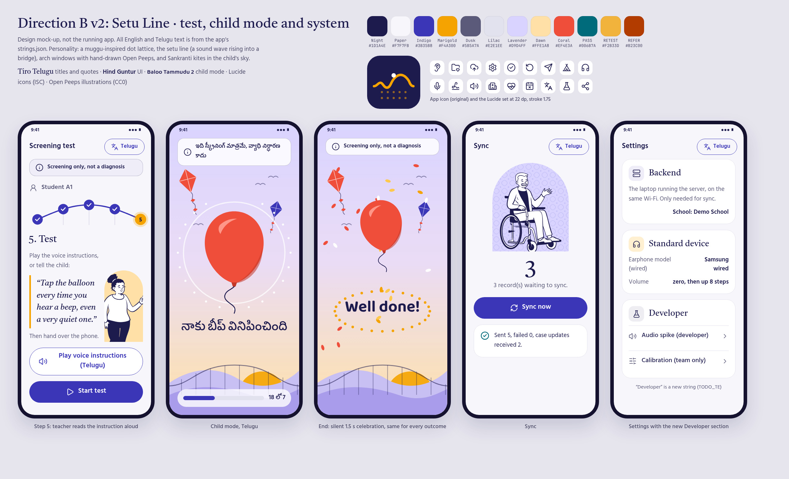

The two first-round directions (A "Open Sky" and B v1) are kept in `docs/design/` for the record.

---

*Original README (DhwaniSarathi team):*

# Dhwani Sarathi

### SiH 1403 : App-Based Audiometer
### Problem Statement:

>To know a person's Hearing Loss, generally we use a Pure Tone Audiometer. To use this it requires a bulk of the instrument to be carried. This testing requires a considerable amount of time for testing. It was observed that a large level of hearing testing, it is consuming much time. So a hand-held Mobile phone operated APP BASED AUDIOMETER will be of immense useful in finding and detecting hearing loss in children in schools

### Motivation:
Introducing an app-based audiometer for school screenings revolutionizes the way we detect and address hearing loss in children. This mobile phone-operated solution offers unparalleled accessibility, convenience, and cost-effectiveness, drastically reducing testing time while ensuring early detection. By leveraging modern technology, this app empowers healthcare providers, educators, and parents to swiftly identify potential hearing issues, enabling timely intervention and fostering better academic and social outcomes for children.

### Features of App
- Pure Tone Audiometry Test
- Results, Analysis, and Interpretation of Test
- Classroom Based management system with Analytics
- Connect to the Nearest Doctor
- Digitization of physical audiometry documents
- and many more...

### Tech Stack
- React Native
- Django

## Screenshots
<h3>Authentication</h3>
<p>
 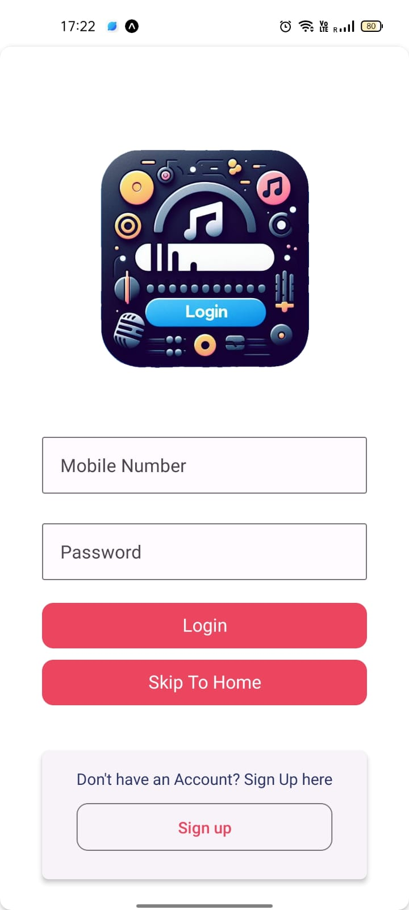&emsp;
 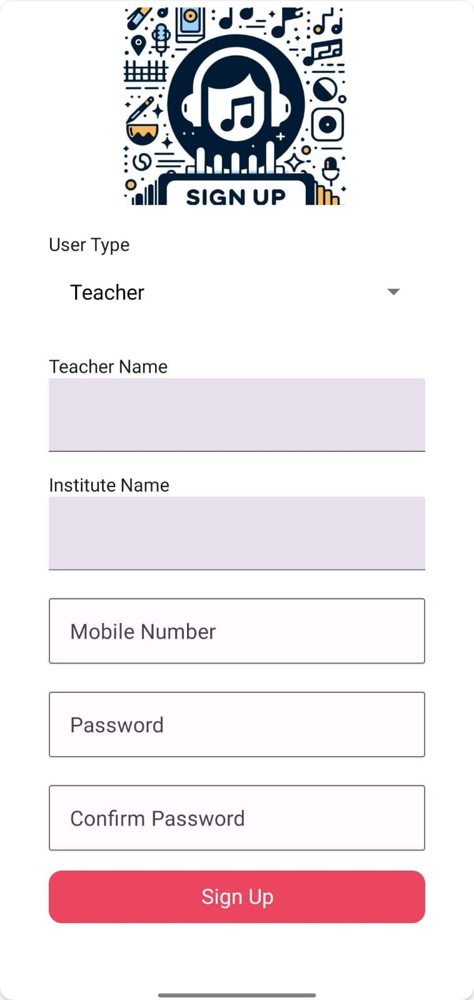&emsp;
  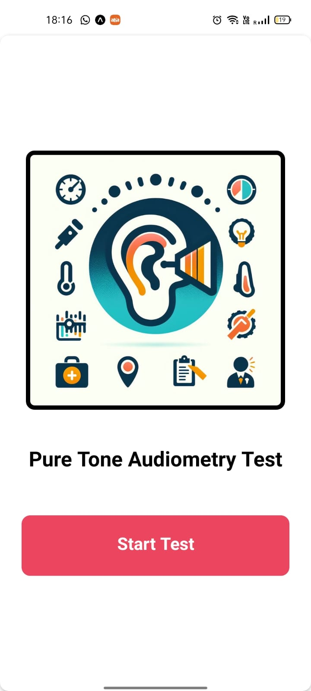&emsp;
</p>

<p>
<h3>User View</h3>
 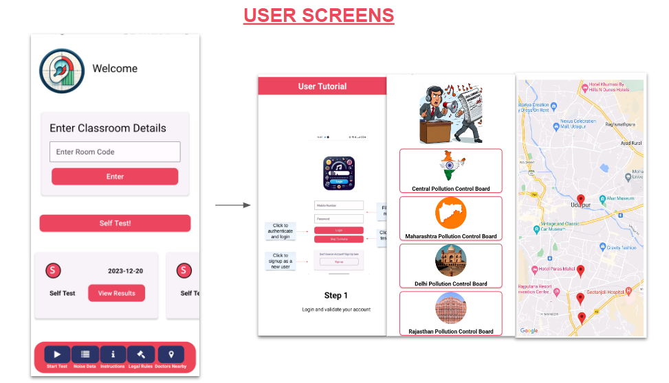&emsp;
</p>

<h3>Preliminary Checks</h3>
<p>
 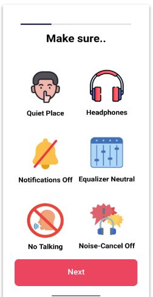&emsp;
 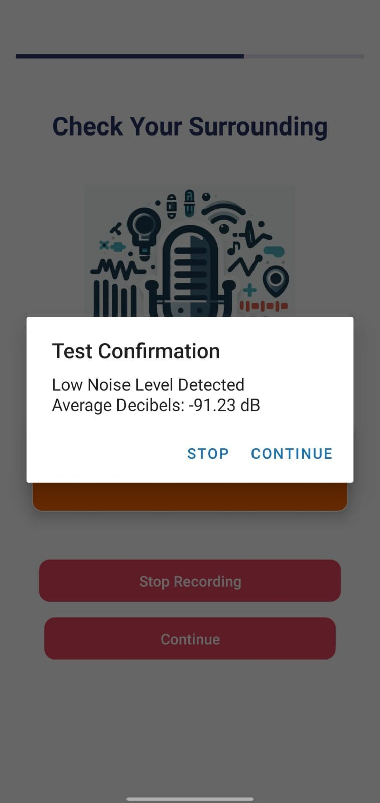&emsp;
 &emsp;
 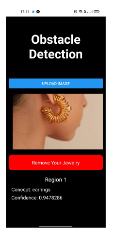&emsp;
</p>

<h3>Test</h3>
<p>
 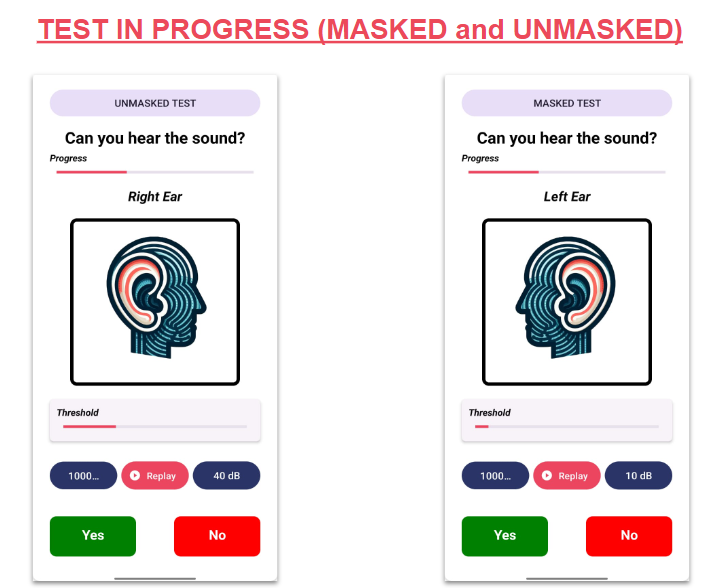&emsp;
</p>

<h3>Results</h3>
<p>
 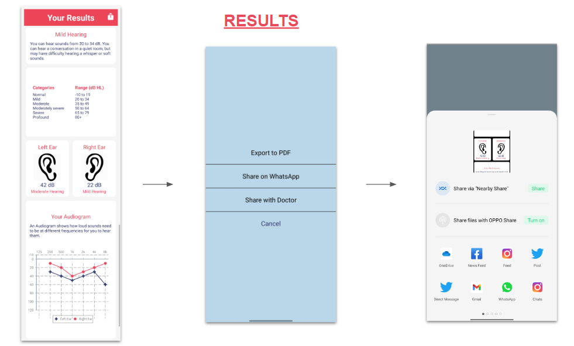&emsp;
 <br>
 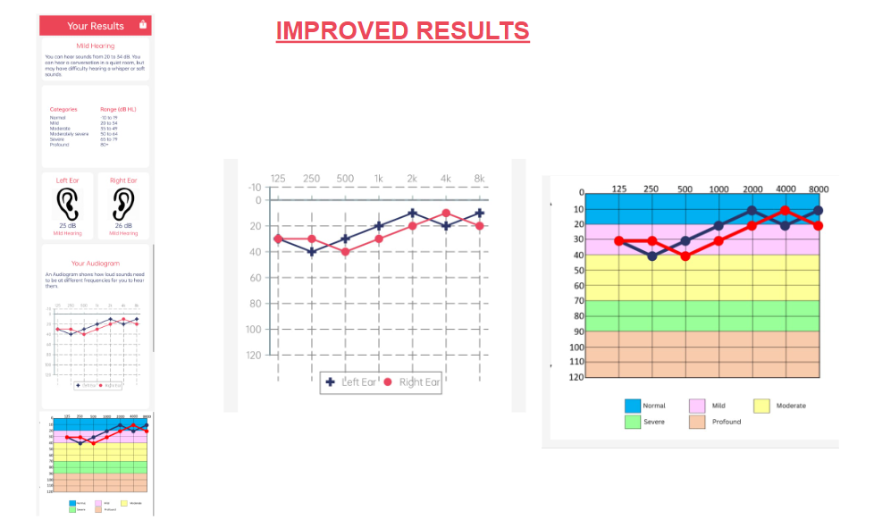&emsp;
</p>

<h3>Teacher View</h3>
<p>
 &emsp;
 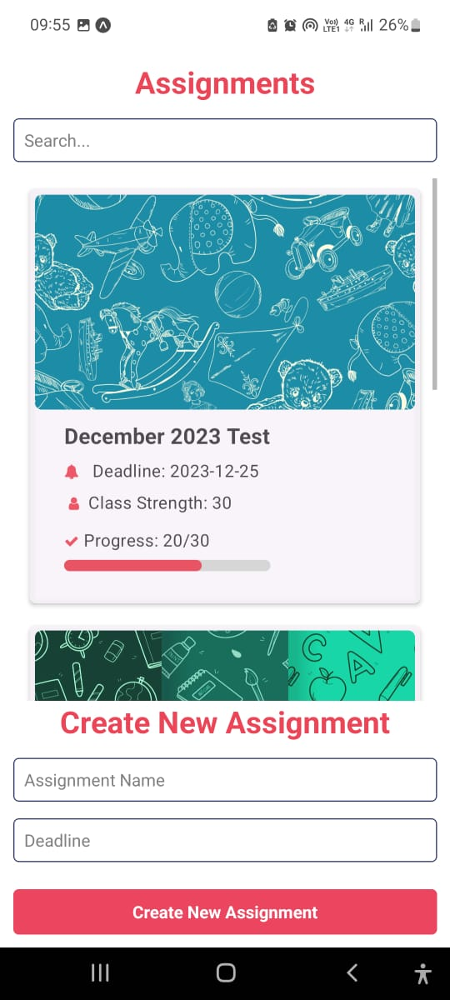&emsp;
</p>

<p>
<h3>Analytics</h3>
 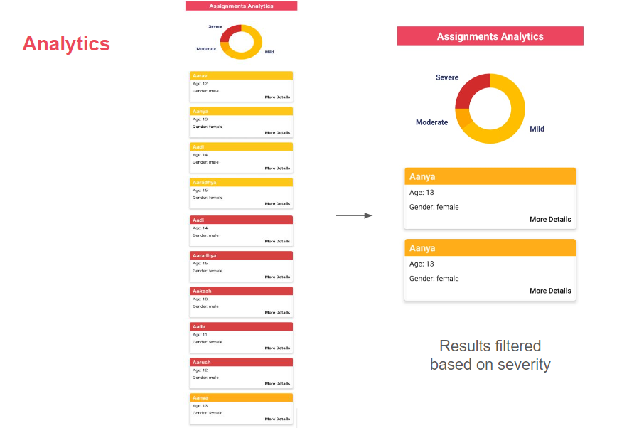&emsp;
</p>

## Getting Started
### Firebase
- Create a Firebase account
- Add the firebase config in FirebaseConfig.js in audiometer/
  
### Frontend
- Clone the repository
- Run the below commands:

```shell
cd audiometer
npm install
npm run web
```
- Change **ip** value to address in the command line in the file audiometer/app/Constants/ip.js

### Backend
- Run the below commands:
```shell
cd server 
```
- Create Virtual Environment
  
You can use multiple methods to create a virtual environment, whatever suits your need

##### Conda
```shell
conda create -n venv python=3.6.3 anaconda
conda activate venv
```
#### Virtualenv

##### Windows
```shell
python -m venv venv   
.\venv\Scripts\Activate
```

##### Linux
```shell
python3 -m venv venv 
source venv/bin/activate
```

- Install the requirements and run server
```shell
pip install -r requirements.txt
#Intialize DB data/Create Models in DB
python manage.py makemigrations
python manage.py migrate

cd backend
python manage.py runserver <ip_address>:80/<ip_address>:8081 

#Here <ip_address> is the IP address on which the expo is running
```
## Team
<p>
    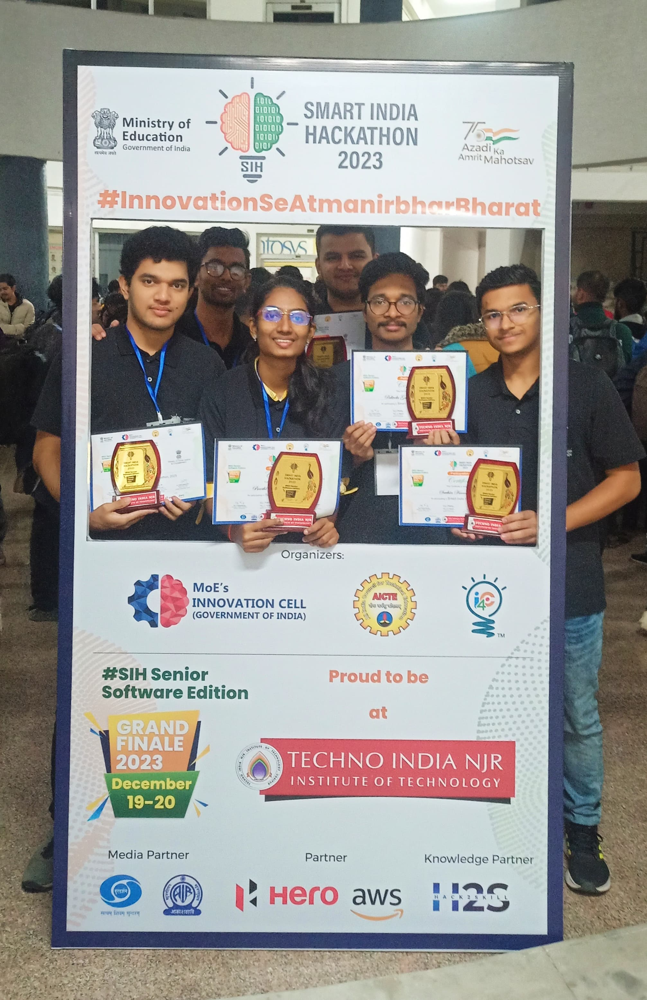&emsp;
</p>
<p>
    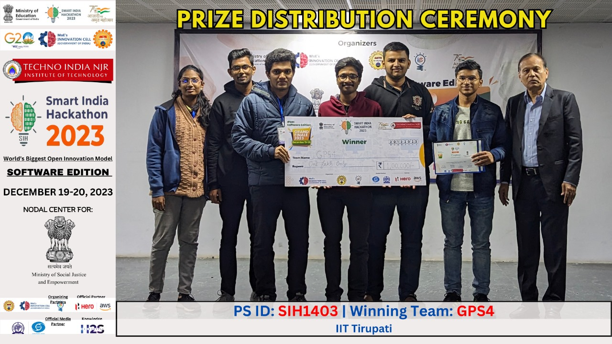&emsp;
    </p>

**Team Members** 

- Sachin Kumar Sahu
- Palivela Ganesh Priyatham
- Preethi Varsha Marivina
- Siddhartha G
- Swami Ramchandra Kedari
- Sirish Sekhar

### References
- Charih, François, and James R. Green. "Audiogram Digitization Tool for Audiological Reports." IEEE Access 10 (2022): 110761-110769.
- [Machine Learning in Audiology: Applications and Implications](https://repository.library.carleton.ca/concern/etds/gt54kp02t).


