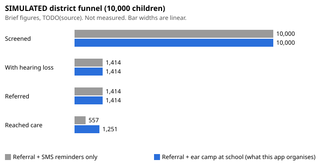

# Evaluation results

Generated by `python -m eval.report` from commit `df07f36a56f458bf793ccb3fd116b2739acd3294 (plus uncommitted changes)`, config_version 0.3.0. Do not edit by hand.

Labels: **SIMULATED** = model output, not measured. **PROPOSED** = plan for a future pilot, not done. NHANES rows use real public US survey audiograms to test the rule logic only. None of this is accuracy of the app in Indian children. Screening and referral tool, not a diagnosis.

### SIMULATED district funnel

SIMULATED, not measured. 10,000 children; prevalence 14.14% and follow-up rates from the challenge brief (TODO(source)); ideal screen (sensitivity 100%, specificity 100%) so only follow-up differs. Stops at reaching care: no treatment data.

| Stage (SIMULATED, expected counts) | Referral + SMS reminders only | Referral + ear camp at school (what this app organises) |
|---|---|---|
| Enrolled | 10,000 | 10,000 |
| Screened | 10,000 | 10,000 |
| With hearing loss (brief prevalence) | 1,414 | 1,414 |
| Referred | 1,414 | 1,414 |
| Children with hearing loss who reach care | 557 | 1,251 |
| Missed by the screen | 0 | 0 |

Difference (SIMULATED): 694 more children with hearing loss reach care per 10,000 enrolled with school camps than with SMS reminders only, if the brief's rates hold here.

One seeded stochastic district (seed 2026, SIMULATED): Referral + SMS reminders only: 539 reach care; Referral + ear camp at school (what this app organises): 1,223 reach care.

#### SIMULATED one-way sweeps (children with hearing loss reaching care, expected)

| Parameter | Value | Referral + SMS reminders only | Referral + ear camp at school (what this app organises) | Referred |
|---|---|---|---|---|
| prevalence | 0.05 | 197 | 442 | 500 |
| prevalence | 0.1 | 394 | 885 | 1,000 |
| prevalence | 0.1414 | 557 | 1,251 | 1,414 |
| prevalence | 0.18 | 709 | 1,593 | 1,800 |
| screen_sensitivity | 0.7 | 390 | 876 | 990 |
| screen_sensitivity | 0.8 | 446 | 1,001 | 1,131 |
| screen_sensitivity | 0.9 | 501 | 1,126 | 1,273 |
| screen_sensitivity | 1.0 | 557 | 1,251 | 1,414 |
| screen_specificity | 0.85 | 557 | 1,251 | 2,702 |
| screen_specificity | 0.9 | 557 | 1,251 | 2,273 |
| screen_specificity | 0.95 | 557 | 1,251 | 1,843 |
| screen_specificity | 1.0 | 557 | 1,251 | 1,414 |

#### SIMULATED Monte Carlo (1000 runs, seed 2026)

Assumed ranges (illustrative, not data): prevalence [0.1, 0.18], sensitivity [0.8, 1.0], specificity [0.9, 1.0], follow-up +/- 0.1.

| Children with hearing loss reaching care (SIMULATED) | Median | 5th percentile | 95th percentile |
|---|---|---|---|
| Referral + SMS reminders only | 484 | 316 | 701 |
| Referral + ear camp at school (what this app organises) | 1,104 | 788 | 1,460 |
| School camp minus SMS only | 604 | 395 | 894 |

### NHANES rule-logic evaluation

US NHANES youth audiograms, unweighted sample counts. Tests the **rule logic** only (config + rule engine), not the app on a phone, and not Indian children. Screening, not diagnosis.

- Children aged 6-18 with all 8 thresholds: **5456** (737 excluded for a missing threshold). 2005-06: 1767, 2007-08: 994, 2009-10: 1087, 2017-18: 1608. Ages 6-11: 684 (2017-18 only); 12-18: 4772.
- **Assumption A1** (screening level): 20 dB HL. Source: American Academy of Audiology (2011), Childhood Hearing Screening Guidelines, Summary of recommendations, pure tone screening items 3 and 6: 1000, 2000, 4000 Hz at 20 dB HL; no response at any frequency in either ear is a failure. Our app plays at 'dB re: team baseline'; treating that as 20 dB HL is an assumption.
- **Assumption A2** (reference): WHO (2021) World report on hearing, Table 1.3 (ISBN 978-92-4-002048-1). WHO says its grades are for epidemiological use and applicable to adults.
- Sample share positive (unweighted; not a prevalence estimate): WHO 2021 hearing loss: better-ear PTA4 (0.5/1/2/4 kHz) >= 20 dB HL: 54 (1.0%); WHO 2021 any grade incl. 'unilateral' (better ear < 20, worse ear >= 35 dB HL): 89 (1.6%); ASSUMPTION: worse-ear PTA4 >= 20 dB HL (WHO mild cut-off applied per ear): 224 (4.1%).

| Scenario | Reference definition | Positives / negatives | Sensitivity (REFER) 95% CI | Specificity (not REFER) 95% CI | Positives that PASSED | RETEST rate |
|---|---|---|---|---|---|---|
| Ideal, 1/2/4 kHz | WHO 2021 hearing loss: better-ear PTA4 (0.5/1/2/4 kHz) >= 20 dB HL | 54 / 5402 | 100.0% (93.4-100.0%) | 92.6% (91.8-93.2%) | 0.0% | 0.0% |
| Ideal, 1/2/4 kHz | WHO 2021 any grade incl. 'unilateral' (better ear < 20, worse ear >= 35 dB HL) | 89 / 5367 | 100.0% (95.9-100.0%) | 93.2% (92.5-93.8%) | 0.0% | 0.0% |
| Ideal, 1/2/4 kHz | ASSUMPTION: worse-ear PTA4 >= 20 dB HL (WHO mild cut-off applied per ear) | 224 / 5232 | 94.6% (90.9-96.9%) | 95.3% (94.7-95.9%) | 5.4% | 0.0% |
| Ideal, + 500 Hz (quiet room) | WHO 2021 hearing loss: better-ear PTA4 (0.5/1/2/4 kHz) >= 20 dB HL | 54 / 5402 | 100.0% (93.4-100.0%) | 89.3% (88.4-90.1%) | 0.0% | 0.0% |
| Ideal, + 500 Hz (quiet room) | WHO 2021 any grade incl. 'unilateral' (better ear < 20, worse ear >= 35 dB HL) | 89 / 5367 | 100.0% (95.9-100.0%) | 89.9% (89.0-90.7%) | 0.0% | 0.0% |
| Ideal, + 500 Hz (quiet room) | ASSUMPTION: worse-ear PTA4 >= 20 dB HL (WHO mild cut-off applied per ear) | 224 / 5232 | 100.0% (98.3-100.0%) | 92.2% (91.4-92.9%) | 0.0% | 0.0% |
| SIMULATED measurement error, 1/2/4 kHz | WHO 2021 hearing loss: better-ear PTA4 (0.5/1/2/4 kHz) >= 20 dB HL | 54 / 5402 | 100.0% (93.4-100.0%) | 92.7% (91.9-93.3%) | 0.0% | 0.0% |
| SIMULATED measurement error, 1/2/4 kHz | WHO 2021 any grade incl. 'unilateral' (better ear < 20, worse ear >= 35 dB HL) | 89 / 5367 | 100.0% (95.9-100.0%) | 93.3% (92.6-93.9%) | 0.0% | 0.0% |
| SIMULATED measurement error, 1/2/4 kHz | ASSUMPTION: worse-ear PTA4 >= 20 dB HL (WHO mild cut-off applied per ear) | 224 / 5232 | 92.0% (87.7-94.9%) | 95.3% (94.7-95.9%) | 8.0% | 0.0% |

Ideal = a tone is heard if the NHANES threshold <= 20 dB HL; no guessing, no lapses. SIMULATED = logistic detection, slope 2.0 dB, lapse 2%, no guessing (assumption A3, placeholders).

#### SIMULATED: partial guessing (reference: WHO any grade incl. unilateral)

Each trial, tone or silent, gets a random in-window tap with the given probability.

| Guess rate per trial | REFER rate (all) | RETEST rate (all) | Sensitivity | Specificity | Positives that PASSED |
|---|---|---|---|---|---|
| 0.00 | 8.2% | 0.0% | 100.0% | 93.3% | 0.0% |
| 0.05 | 7.0% | 1.3% | 94.4% | 94.4% | 1.1% |
| 0.10 | 5.7% | 5.9% | 83.1% | 95.6% | 3.4% |
| 0.20 | 3.3% | 19.6% | 62.9% | 97.7% | 13.5% |
| 0.30 | 1.4% | 35.8% | 28.1% | 99.0% | 30.3% |
| 0.50 | 0.1% | 69.0% | 0.0% | 99.9% | 15.7% |

#### SIMULATED: calibration error (tones played this many dB louder (+) or softer (-) than intended)

| Level error (dB) | REFER rate (all) | RETEST rate (all) | Sensitivity | Specificity |
|---|---|---|---|---|
| -10 | 39.4% | 0.0% | 100.0% | 61.6% |
| -5 | 17.6% | 0.0% | 100.0% | 83.8% |
| +0 | 8.2% | 0.0% | 100.0% | 93.3% |
| +5 | 4.3% | 0.0% | 96.6% | 97.3% |
| +10 | 2.7% | 0.0% | 89.9% | 98.8% |

### PROPOSED deployment cost model

**Proposed** plan for a future school pilot (SFIC field-testing support). Not tested or measured in any school. Software: **Rs 0** in every scenario. Prices: team estimate, online retail price, Oct 2026 (phone Rs 10,000, 3 years; wired earphones Rs 400, 1 year).

Planning inputs: 5 min per child including setup, 1 h of screening per phone per day. Each student misses about that many minutes once a year; the students-per-phone guideline limits how long a screening round runs, not student time.

| Students on one phone (PROPOSED) | Children per phone per day | School days to finish |
|---|---|---|
| 250 | 12 | 21 |
| 400 | 12 | 33 |
| 1,000 | 12 | 83 |

Guideline (PROPOSED): about 250 students per calibrated phone, acceptable up to 400. Phones needed = ceil(students / 250).

| School size | Scenario (PROPOSED) | Kits | School days to finish | Upfront | Equipment per year | Per child per year | Software | Teacher time | Teacher cost |
|---|---|---|---|---|---|---|---|---|---|
| 250 | A. School phone + earphones (recommended) | 1 | 20.8 | Rs 10,400 | Rs 3,733 | Rs 14.9 | Rs 0 | 1,250 min | TODO(source) |
| 250 | B. Teacher's own phone, school buys earphones | 1 | 20.8 | Rs 400 | Rs 400 | Rs 1.6 | Rs 0 | 1,250 min | TODO(source) |
| 250 | C. One earphone kit per class teacher, on their own phones | 7 | 3.3 | Rs 2,800 | Rs 2,800 | Rs 11.2 | Rs 0 | 1,250 min | TODO(source) |
| 400 | A. School phone + earphones (recommended) | 2 | 20.8 | Rs 20,800 | Rs 7,467 | Rs 18.7 | Rs 0 | 2,000 min | TODO(source) |
| 400 | B. Teacher's own phone, school buys earphones | 2 | 20.8 | Rs 800 | Rs 800 | Rs 2.0 | Rs 0 | 2,000 min | TODO(source) |
| 400 | C. One earphone kit per class teacher, on their own phones | 10 | 3.3 | Rs 4,000 | Rs 4,000 | Rs 10.0 | Rs 0 | 2,000 min | TODO(source) |
| 1,000 | A. School phone + earphones (recommended) | 4 | 20.8 | Rs 41,600 | Rs 14,933 | Rs 14.9 | Rs 0 | 5,000 min | TODO(source) |
| 1,000 | B. Teacher's own phone, school buys earphones | 4 | 20.8 | Rs 1,600 | Rs 1,600 | Rs 1.6 | Rs 0 | 5,000 min | TODO(source) |
| 1,000 | C. One earphone kit per class teacher, on their own phones | 25 | 3.3 | Rs 10,000 | Rs 10,000 | Rs 10.0 | Rs 0 | 5,000 min | TODO(source) |

Scenario notes:

- **A. School phone + earphones (recommended)**: The school buys a phone + earphones (Rs 10,400 per kit). One calibrated phone+earphone pair gives consistent test levels; child data stays on a school device. Buy every phone of the same model with the same earphone model.
- **B. Teacher's own phone, school buys earphones**: Cheapest. Not recommended until per-model calibration exists (roadmap): each phone model needs its own calibration, test levels vary across models until then, and child data sits on a personal phone.
- **C. One earphone kit per class teacher, on their own phones**: Its advantage is speed, not cost: every class teacher screens their own class at the same time, so the whole school finishes in about the days one class takes (see the days column). It costs more than B (one kit per class instead of one per 250 students) and less than A (no phones bought). The same calibration and privacy issues as B, multiplied by the number of phone models, and less convenient to manage.

Future cost, not in the totals: SMS reminders (2 per referred child at TODO(source) per message). Reminders are stubbed today.
Scenario C counts class teachers as ceil(students / 40) (class size TODO(source)).

### Device trial sessions (Phase 5, raw files on this laptop)

| File | Outcome | Room noise | Duration (s) | Catch taps | Out of window | Noise replays | Late-start replays | Tap from play() ms min / median / max | Play latency ms min / median / max | Tap from playback start ms min / median / max | Starts over 1000 ms |
|---|---|---|---|---|---|---|---|---|---|---|---|
| session-d292718b-2cde-4fd3-b3f6-12ca9fb18eb0.json | PASS | -1.3 | 104 | 0/4 | 1/16 | 0 | 0 | 1168 / 1554 / 3414 | 144 / 486 / 2243 | 806 / 1098 / 1481 | 3/16 |

### Biological calibration (team volunteers, not children)

Volunteers: V1, V2, V3, V4, V5, V6, V7. Levels: dB re tone full scale at player volume 1.0.

| Frequency | Team baseline (median, run 1, both ears) | Ears |
|---|---|---|
| 500 Hz | -35.0 | 14 |
| 1000 Hz | -60.0 | 14 |
| 2000 Hz | -60.0 | 14 |
| 4000 Hz | -60.0 | 14 |

Within-run 1000 Hz repeat: 14 pairs, mean absolute difference 0.4 dB, 100% within 5 dB, mean shift +0.4 dB.

Review (not excluded):
- V2 left 500 Hz: -50, much lower than others' median -32.5 (check fitting/tapping)
- V2 right 500 Hz: -50, much lower than others' median -32.5 (check fitting/tapping)
- V4 left 500 Hz: -55, much lower than others' median -32.5 (check fitting/tapping)

WARNING: no spread at 1000 Hz, 2000 Hz, 4000 Hz: every threshold within 5 dB. Real thresholds differ between people, so this is probably the phone's playback floor, not hearing (docs/ERROR_LOG.md ERR-044). Confirm before pasting the baseline.

Config now: PROVISIONAL baseline {"500": -35, "1000": -60, "2000": -60, "4000": -60} (`calibration.provisional`, ERR-044). 1-4 kHz values are upper bounds limited by the phone's playback floor, so those tones may be louder than intended and the screen may miss milder loss until the Stage 2 recalibration (docs/ROADMAP.md).

Paste into config/screening.json `calibration.baseline_dbfs.value` (and record the source):

    {"500": -35.0, "1000": -60.0, "2000": -60.0, "4000": -60.0}

Then set `screening_level_db_re_team_baseline.value` to 20 (owner decision 2026-10-19). With both set, the app plays calibrated levels and the UNCALIBRATED note disappears.
